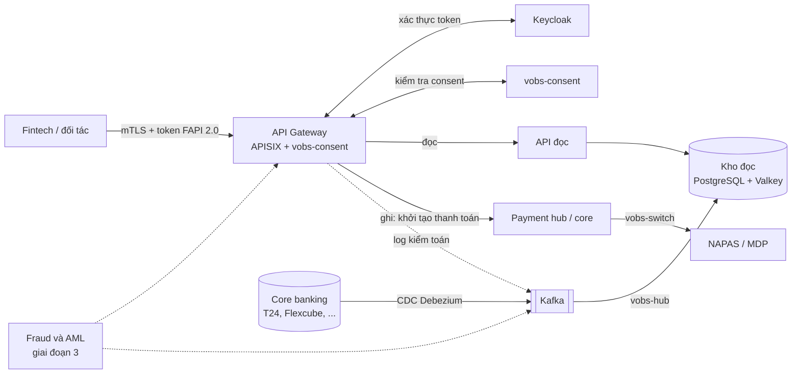

# Kiến trúc

VOBS tách luồng đọc khỏi luồng ghi. Request đọc lấy dữ liệu từ Integration Hub; lệnh ghi đi thẳng vào hệ thống
của ngân hàng.

Mọi request từ đối tác đi qua API Gateway, nơi kiểm tra token FAPI và consent. Debezium đồng bộ liên tục dữ liệu
từ core vào kho đọc qua Kafka. Lệnh thanh toán đi tới payment hub rồi ra NAPAS hoặc MDP qua adapter.

## Nguyên tắc thiết kế

- **Việt Nam trước:** chuẩn Thông tư 64, VietQR, NAPAS, MDP, CCCD gắn chip, tên tiếng Việt là tính năng lõi.
- **Theo chuẩn quốc tế:** OpenAPI 3.1, OAuth 2.0 và FAPI 2.0, ISO 20022, BIAN.
- **Module độc lập:** ngân hàng có thể chỉ lấy thư viện ISO 20022 hoặc chỉ lấy module consent.
- **Không ghi vào core qua đường tắt:** Integration Hub chỉ phục vụ đọc (CQRS).
- **Triển khai on-premise:** chạy trên Kubernetes của ngân hàng, không phụ thuộc cloud ngoài.
- **Kiểm toán được từ đầu:** mọi lần gọi API, cấp hay thu hồi consent đều có bản ghi không sửa được.
- **Bảo mật chuỗi cung ứng:** bản phát hành ký số, có SBOM, có quy trình công bố lỗ hổng.

## Yêu cầu phi chức năng

Mục tiêu khởi điểm, cần xác nhận với ngân hàng thí điểm.

| Yêu cầu | Mục tiêu | Cách đáp ứng |
| --- | --- | --- |
| Độ trễ API đọc | p99 < 200 ms | Đọc từ kho đọc, không gọi core |
| Độ trễ đồng bộ từ core | p99 < 2 giây | Debezium (Oracle LogMiner, Db2, SQL Server) → Kafka |
| Bảo vệ core | Tải lên core không tăng theo số đối tác | Giới hạn tần suất theo đối tác; lệnh ghi qua hàng đợi |
| Tính sẵn sàng lớp API | 99,95%, cả lúc core chạy batch cuối ngày | Kho đọc độc lập với core, nhiều bản sao |
| Chống sự cố trung tâm dữ liệu | DC/DR | Kafka MirrorMaker 2; PostgreSQL HA (CloudNativePG) |
| RPO | Gần 0 với consent và log kiểm toán | Sao chép đồng bộ; kho đọc dựng lại được từ CDC snapshot |
| RTO | < 30 phút | GitOps (Argo CD), kịch bản chuyển vùng, diễn tập định kỳ |

## Bảo mật

| Yêu cầu | Cách đáp ứng |
| --- | --- |
| Xác thực đối tác và token | FAPI 2.0 trên Keycloak: mTLS, token gắn chứng thư, Pushed Authorization Request |
| Phân quyền chi tiết | OpenFGA hoặc OPA theo consent và phạm vi dữ liệu |
| Khóa và bí mật | OpenBao; khóa ký trong HSM của ngân hàng qua PKCS#11 |
| Mã hóa | TLS 1.3 nội bộ và bên ngoài; mã hóa theo trường với dữ liệu cá nhân trong kho đọc |
| WAF | Coraza + OWASP Core Rule Set tại gateway |
| Chuỗi cung ứng | Sigstore cosign, SBOM bằng Syft, quét bằng Trivy, hướng tới SLSA |

## Tuân thủ

| Quy định | Cách đáp ứng |
| --- | --- |
| Thông tư 64/2024/TT-NHNN | Bộ đặc tả đủ danh mục Điều 6, kiểm tra độ phủ trong CI; bộ kiểm thử tuân thủ mở. Chi tiết: [tt64.md](tt64.md) |
| Thông tư 09/2020/TT-NHNN, Nghị định 85/2016/NĐ-CP | Gói tuân thủ: ánh xạ kiểm soát sang cấu hình, kèm pentest độc lập |
| Luật Bảo vệ dữ liệu cá nhân số 91/2025/QH15 (thay Nghị định 13/2023/NĐ-CP) | Consent theo phạm vi và thời hạn, thu hồi được; tối thiểu hóa dữ liệu tại gateway |
| Lưu trữ dữ liệu trong nước | On-premise hoặc cloud trong nước; bộ cài air-gapped |
| Log kiểm toán không sửa được | Ghi nối tiếp vào Kafka, lưu kiểu WORM, chuỗi hash; giữ tối thiểu 3 tháng, sao lưu tối thiểu 1 năm (Điều 11 Thông tư 64) |
| PCI DSS | Không lưu số thẻ; token hóa để giữ ngoài phạm vi PCI |

## Quy tắc nghiệp vụ

Quy tắc hay thay đổi theo quy định hoặc theo chính sách từng ngân hàng được viết bằng bảng quyết định
[RuleStone](https://github.com/xvalleycorp/RuleStone) (Apache-2.0), không viết trong mã Java. Mỗi bảng có phiên bản và
ngày hiệu lực, được kiểm tra kiểu khi nạp. Mỗi quyết định có bản ghi kiểm toán gồm phiên bản bảng, hash nội dung bảng
và mã lý do, không chứa giá trị input.

| Vị trí | Quy tắc | Trạng thái |
| --- | --- | --- |
| `vobs-consent` | Nhận yêu cầu consent: phạm vi theo loại bên thứ ba (Điều 5), thời hạn tối đa (Điều 11), chính sách riêng của ngân hàng | Đang dùng |
| Khởi tạo thanh toán, nạp và rút ví (giai đoạn 2) | Hạn mức theo giao dịch và theo ngày, phí, mức xác thực bắt buộc theo số tiền; vi phạm trả `422` kèm mã lý do | Dự kiến, khi có service thanh toán |
| Module Decision, Fraud và AML (giai đoạn 3) | Quy tắc giám sát giao dịch, so khớp tên tiếng Việt với danh sách cần sàng lọc | Dự kiến |
| Luồng chạy trên Temporal | Quyết định gọi trong workflow, giữ cố định phiên bản bảng khi replay (`rulestone-temporal`) | Dự kiến |

Hai chỗ **không** dùng bảng quyết định: kiểm tra consent tại gateway (logic trạng thái của consent, giữ trong mã) và
giới hạn tần suất (cấu hình của gateway).

## Vận hành

- Quan sát: OpenTelemetry cho trace, metric và log; Prometheus, Jaeger; Grafana dùng nguyên bản (AGPL, không nhúng).
- Triển khai: Helm chart tổng, Argo CD; nâng cấp không dừng dịch vụ.
- SLO theo từng đối tác: báo cáo độ trễ và tỷ lệ lỗi cho từng fintech.
